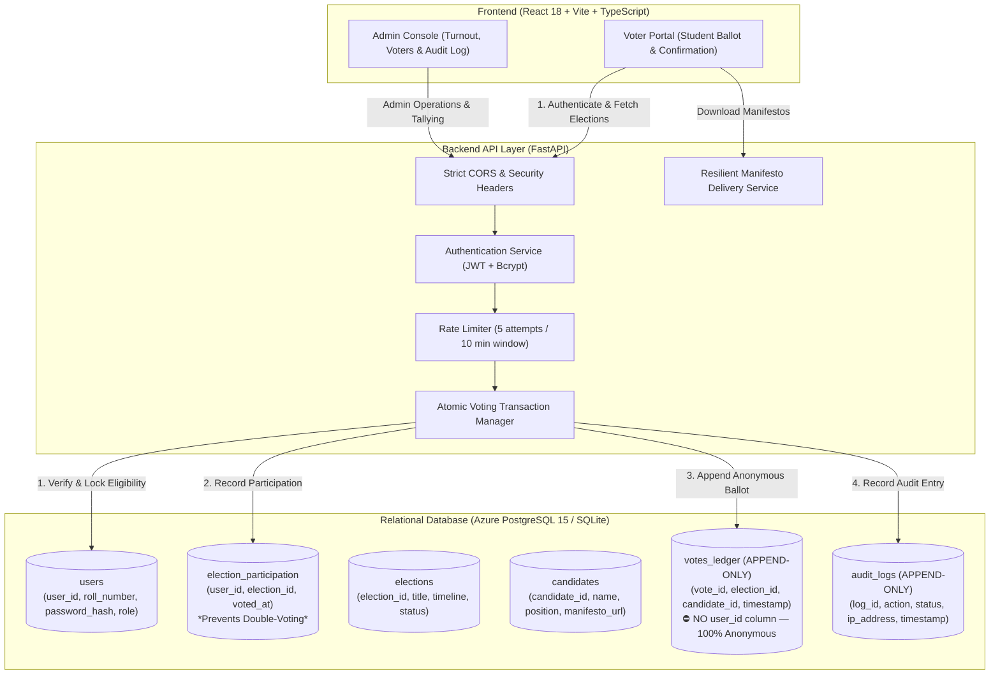

# SecureVote — Campus Election & Electoral Audit Portal

[](https://securevote-frontend.vercel.app)
[](https://securevote-backend-srd5.onrender.com/docs)
[-0078D4?style=for-the-badge&logo=microsoftazure&logoColor=white)](https://portal.azure.com)
[](https://github.com/amrittripathi599-sketch/SecureVote-Zero-Trust-Campus-Election-Commission-Postal/actions)

SecureVote is a secure, privacy-first campus election and electoral audit portal engineered for university student governments, academic departments, and student council balloting. Built with **FastAPI**, **SQLAlchemy 2.0 ORM**, **React 18**, **TypeScript**, and **Tailwind CSS**, SecureVote delivers complete voter privacy by relationally decoupling voter identities from cast ballots while maintaining verifiable electoral integrity through database-enforced append-only audit records.

---

## 🌐 Live Cloud Deployment

The entire SecureVote platform is deployed and publicly accessible in production:

| Component | Platform / Host | Endpoint / URL | Status |
| :--- | :--- | :--- | :--- |
| **Frontend Portal** | **Vercel** | [`https://securevote-frontend.vercel.app`](https://securevote-frontend.vercel.app) | 🟢 Live & Production-Ready |
| **Backend REST API** | **Render Web Service** | [`https://securevote-backend-srd5.onrender.com`](https://securevote-backend-srd5.onrender.com) | 🟢 Live (Port 10000) |
| **API Health Probe** | **Render Web Service** | [`/api/health`](https://securevote-backend-srd5.onrender.com/api/health) | 🟢 `{"status":"healthy"}` |
| **Swagger Interactive Docs** | **Render Web Service** | [`/docs`](https://securevote-backend-srd5.onrender.com/docs) | 🟢 Interactive OpenAPI Spec |
| **Relational Database** | **Azure Container Instances** | `securevote-db-amrit.c7b6ecd3crb0c6fq.southeastasia.azurecontainer.io:5432` | 🟢 PostgreSQL 15 Running |
| **Automated Test Suite** | **Local & CI/CD** | `pytest backend/tests` | 🟢 26/26 Tests Passing |

---

## 🏛️ System Architecture

SecureVote separates voter identity verification from ballot storage to ensure that no individual vote can ever be linked back to the student who cast it.



---

## 🛠️ Technology Stack

- **Frontend**:
  - React 18 with TypeScript and Vite
  - Tailwind CSS for responsive styling
  - Lucide React for consistent UI iconography
  - Recharts for real-time election turnout visualization
  - Axios with automated JWT authorization interceptors
- **Backend**:
  - Python 3.11+ / FastAPI
  - SQLAlchemy 2.0 ORM with typed declarative models
  - Pydantic v2 for request/response validation
  - Uvicorn ASGI server
  - PyJWT for token generation and validation
  - Passlib with Bcrypt for salted password hashing
- **Database**:
  - **Production**: Azure Container Instances running PostgreSQL 15
  - **Local Development**: SQLite with zero configuration required
- **Cloud Infrastructure**:
  - Frontend hosted on Vercel with automatic continuous deployment
  - Backend hosted on Render Web Service
  - Database provisioned on Microsoft Azure

---

## 🔐 Security & Privacy Features

1. **Ballot Privacy Guarantee**:
   The `votes_ledger` table strictly contains **no `user_id` or voter reference**. When an eligible student votes, the system registers *that* they participated (in `election_participation`) to prevent duplicate voting, but their candidate choice is committed separately into `votes_ledger` with zero linkage to the voter.
2. **Immutable Append-Only Records**:
   Native database triggers abort any `UPDATE` or `DELETE` attempt on `votes_ledger` and `audit_logs`, preventing retrospective manipulation even by administrative users.
3. **Atomic Voting Transactions**:
   Voter eligibility checks, participation recording, and anonymous ballot logging are wrapped in a single database transaction (`SELECT ... FOR UPDATE` on PostgreSQL). If any step fails, the entire transaction rolls back cleanly.
4. **Brute-Force Rate Limiting**:
   Failed authentication attempts are tracked. After 5 consecutive failed logins for an institutional roll number within 10 minutes, the account is temporarily throttled with HTTP 429.
5. **SQL Injection Prevention**:
   100% of database interactions execute through SQLAlchemy 2.0 ORM with parameterized queries.
6. **Input & File Validation**:
   Candidate manifesto uploads are checked for PDF binary magic bytes (`%PDF-`) and restricted to safe file sizes (max 5 MB).
7. **Security Headers**:
   FastAPI middleware injects OWASP-recommended HTTP response headers (`X-Frame-Options: DENY`, `X-Content-Type-Options: nosniff`, `Strict-Transport-Security`, `Referrer-Policy`).

---

## 👥 Demo Accounts for Evaluation & Testing

The automated seed script initializes the following accounts for evaluation:

| Role | Roll Number | Password | Name / Notes |
| :--- | :--- | :--- | :--- |
| **Chief Election Officer (Admin)** | `ADMIN001` | `Admin@123` | **Mr. Amrit Tripathi** (Full administrative controls: create elections, add voters, manage candidates, view audit logs, turnout statistics, reset passwords) |
| **Student Voter 1** | `STU001` | `Voter@123` | Aarav Sharma (Nominated for Council President) |
| **Student Voter 2** | `STU002` | `Voter@123` | Bhavna Patel (Nominated for Vice President) |
| **Student Voter 3** | `STU003` | `Voter@123` | Chirag Verma (Nominated for General Secretary) |
| **Student Voter 4** | `STU004` | `Voter@123` | Divya Nair (Eligible student voter) |
| **Student Voter 5** | `STU005` | `Voter@123` | Eshan Gupta (Eligible student voter) |

*Active Demo Election*: **"Student Council Election 2026"** (Status: `open`, 3 candidates nominated with accessible manifesto documents).

---

## 💻 Local Development Setup

The project can be run locally using SQLite with no external cloud dependencies required.

### 1. Backend Setup
```bash
# Navigate to the backend directory
cd backend

# Create and activate Python virtual environment
# Windows:
python -m venv .venv
.\.venv\Scripts\Activate.ps1
# Linux / macOS:
# python3 -m venv .venv && source .venv/bin/activate

# Install required packages
pip install -r requirements.txt

# Start the local FastAPI server (runs on port 8000)
uvicorn app.main:app --reload --port 8000
```
- API Documentation (Swagger): [http://localhost:8000/docs](http://localhost:8000/docs)
- Health Check: [http://localhost:8000/api/health](http://localhost:8000/api/health)

### 2. Frontend Setup
```bash
# In a separate terminal, navigate to frontend
cd frontend

# Install dependencies
npm install

# Start Vite development server
npm run dev
```
Open your browser at **[http://localhost:5173](http://localhost:5173)** to interact with the voting portal.

---

## 🧪 Automated Testing Suite

The repository includes comprehensive backend unit and integration tests covering the complete electoral lifecycle:

```bash
# Run pytest from the project root:
backend\.venv\Scripts\pytest -v

# Or from inside backend/:
cd backend
pytest -v
```

### Test Coverage Summary (26/26 Passing):
- **`test_voting.py`** (4 tests):
  - Anonymous ballot submission with privacy verification
  - Double-voting prevention (HTTP 409 Conflict)
  - Admin voting prevention (HTTP 403 Forbidden)
  - Mid-transaction failure rollback and atomicity
- **`test_admin.py`** (11 tests):
  - Voter access restriction on administrative endpoints (HTTP 403)
  - Election creation and timeline updates
  - Candidate nomination and PDF magic-byte validation
  - Audit log event recording and retrieval
  - Turnout analytics and tally calculation
  - Election lifecycle management (Conclude & Resume)
  - Single voter onboarding and batch voter creation
  - Admin self-service password reset
  - Voter password reset by administrator
- **`test_auth.py`** (5 tests):
  - Successful authentication and token issuance
  - Invalid password rejection (HTTP 401)
  - User profile endpoint (`/api/auth/me`)
  - Unauthorized access handling
  - Brute-force rate limiting (HTTP 429 after 5 failed attempts)
- **`test_elections.py`** (3 tests):
  - Active elections listing
  - Election details retrieval
  - Candidate roster query
- **`test_immutability.py`** (3 tests):
  - Direct `UPDATE` on `votes_ledger` blocked by database trigger
  - Direct `DELETE` on `votes_ledger` blocked by database trigger
  - Direct `UPDATE` on `audit_logs` blocked by database trigger

### Frontend Verification:
```bash
cd frontend
npm run build
```
- Passes TypeScript compilation and bundles static assets with Vite in ~4 seconds with zero errors.

---

## 📁 Repository Structure

```
SecureVote/
├── backend/
│   ├── app/
│   │   ├── main.py              # FastAPI application entry point & middleware
│   │   ├── config.py            # Environment settings and security configuration
│   │   ├── database.py          # SQLAlchemy engine, session maker & trigger setup
│   │   ├── models.py            # Relational database models (6 tables)
│   │   ├── schemas.py           # Pydantic request/response schemas
│   │   ├── deps.py              # JWT authentication & rate limiting dependencies
│   │   ├── seed.py              # Demo election & voter initial seeding
│   │   └── routers/
│   │       ├── auth.py          # Login, profile, & session management
│   │       ├── elections.py     # Election directory & details
│   │       ├── candidates.py    # Candidate roster & manifesto retrieval
│   │       ├── votes.py         # Atomic ballot casting endpoint
│   │       ├── admin.py         # Administrative console & voter management
│   │       └── analytics.py     # Turnout statistics & results aggregation
│   ├── tests/                   # Pytest test suite (26 automated tests)
│   ├── uploads/                 # Storage directory for candidate manifesto PDFs
│   └── requirements.txt         # Python package dependencies
│
├── frontend/
│   ├── src/
│   │   ├── api/client.ts        # Axios client with bearer token interceptor
│   │   ├── context/AuthContext  # React context for global auth state
│   │   ├── components/          # Reusable UI components (Navbar, ProtectedRoute, etc.)
│   │   ├── pages/
│   │   │   ├── Login.tsx        # Institutional login page with Caps-Lock warning
│   │   │   ├── VoterDashboard   # Active elections & voting booth entrance
│   │   │   ├── Ballot.tsx       # Confidential voting interface
│   │   │   ├── Confirmation.tsx # Official confirmation code & receipt screen
│   │   │   ├── AdminDashboard   # Admin controls, candidate management & password reset
│   │   │   ├── CreateElection   # Election creation wizard
│   │   │   ├── Results.tsx      # Election turnout and result tallies
│   │   │   └── NotFound.tsx     # 404 error page
│   │   └── App.tsx              # Router configuration and application shell
│   ├── package.json             # Node dependencies and build scripts
│   └── vite.config.ts           # Vite bundler configuration
│
├── docs/                        # Detailed architectural and API documentation
│   ├── ARCHITECTURE.md          # Database design & ballot decoupling analysis
│   ├── API.md                   # OpenAPI endpoint specifications
│   ├── AZURE_DEPLOYMENT.md      # Azure infrastructure configuration guide
│   ├── STRIDE_THREAT_MODEL.md   # Threat model & risk mitigations
│   └── ER_DIAGRAM.md            # Entity-relationship diagrams
└── README.md                    # Project documentation
```

---

## 📚 Technical Documentation

- [docs/ARCHITECTURE.md](./docs/ARCHITECTURE.md) — Detailed explanation of schema design, ballot privacy, and transaction atomicity.
- [docs/API.md](./docs/API.md) — Comprehensive REST API documentation with endpoint schemas and error codes.
- [docs/AZURE_DEPLOYMENT.md](./docs/AZURE_DEPLOYMENT.md) — Cloud deployment guide for Azure App Service, PostgreSQL, Key Vault, and Blob Storage.
- [docs/STRIDE_THREAT_MODEL.md](./docs/STRIDE_THREAT_MODEL.md) — Security threat model and mitigation controls.
- [docs/ER_DIAGRAM.md](./docs/ER_DIAGRAM.md) — Entity-relationship diagrams and database constraint definitions.

---

## 📄 License

This project was developed for academic evaluation and institutional demonstration purposes.
