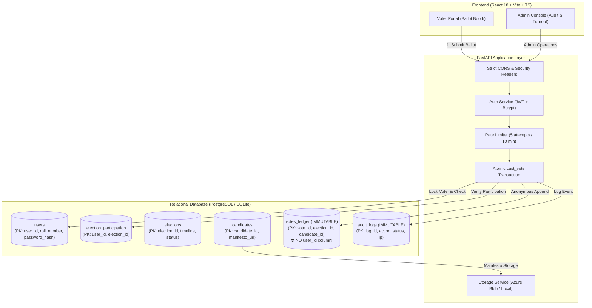

# SecureVote — Zero-Trust Campus Election & Audit Portal

[](https://docs.pytest.org)
[](https://vitejs.dev)
[](https://www.typescriptlang.org)
[](./docs/ARCHITECTURE.md)

SecureVote is a production-quality, zero-trust campus election and audit portal engineered for university student governments, faculty councils, and institutional balloting. Built with **FastAPI**, **SQLAlchemy 2.0 ORM**, **React 18**, **TypeScript**, and **Tailwind CSS**, SecureVote enforces mathematical ballot secrecy in Third Normal Form (3NF) and protects electoral integrity using kernel-level append-only database triggers.

---

## 🏛️ Architecture Overview

SecureVote guarantees voter privacy by physically and relationally separating voter identity from cast ballots.



---

## 🛠️ Tech Stack

- **Frontend**: React 18, Vite, TypeScript, Tailwind CSS, React Router v6, Axios, Recharts, Lucide Icons
- **Backend**: Python 3.11+, FastAPI, SQLAlchemy 2.0 ORM, Pydantic v2, Uvicorn, PyJWT, Bcrypt
- **Database**: PostgreSQL for production (via `DATABASE_URL`), SQLite for local development with zero setup
- **Storage**: Azure Blob Storage SDK (`azure-storage-blob`) with transparent local filesystem fallback (`/uploads`)
- **Testing**: Pytest with in-memory SQLite isolation, HTTPX TestClient

---

## 🔐 Zero-Trust Security Features

1. **3NF Ballot Secrecy**: The `votes_ledger` table contains **NO `user_id` column**. When a student votes, the system registers *that* they voted (in `election_participation`), but their candidate choice is committed to `votes_ledger` with zero voter linkage.
2. **Immutable Append-Only Triggers**: Native database triggers (on both PostgreSQL and SQLite) abort any `UPDATE` or `DELETE` attempt on `votes_ledger` and `audit_logs`.
3. **Atomic Voting Transaction**: Concurrency locking (`SELECT ... FOR UPDATE` on PostgreSQL / immediate transactions on SQLite) prevents double-voting and TOCTOU race conditions. If any exception occurs mid-transaction, all changes roll back completely.
4. **Brute-Force Rate Limiting**: After 5 failed login attempts for a roll number within 10 minutes, the account is throttled with HTTP 429.
5. **SQL Injection Immunity**: 100% of SQL operations execute via SQLAlchemy 2.0 ORM with parameter binding. No string formatting or raw concatenated SQL is permitted.
6. **PDF Magic Byte Inspection**: Uploaded candidate manifestos are verified to start with `%PDF-` binary magic bytes and strictly limited to 5 MB.
7. **Production Key Guard**: The backend refuses to boot in production if `JWT_SECRET` is left as default or shorter than 32 characters.

---

## 👥 Demo Accounts for Faculty Testing

When starting the application with an empty database, the automated seed script (`app/seed.py`) provisions the following accounts:

| Role | Roll Number | Password | Notes |
| :--- | :--- | :--- | :--- |
| **Election Commissioner** | `ADMIN001` | `Admin@123` | Full admin privileges (Create elections, manage candidates, view audit logs, view turnout charts) |
| **Student Voter 1** | `STU001` | `Voter@123` | Aarav Sharma (Nominated for Council President) |
| **Student Voter 2** | `STU002` | `Voter@123` | Bhavna Patel (Nominated for Vice President) |
| **Student Voter 3** | `STU003` | `Voter@123` | Chirag Verma (Nominated for General Secretary) |
| **Student Voter 4** | `STU004` | `Voter@123` | Divya Nair (Uncast ballot, ready to vote) |
| **Student Voter 5** | `STU005` | `Voter@123` | Eshan Gupta (Uncast ballot, ready to vote) |

*Demo Election*: **"Student Council 2026"** (Status: `open`, 3 candidates nominated with sample manifesto PDFs).

---

## 🚀 Local Development Setup

### Prerequisites
- Python 3.11+
- Node.js 18+ and npm

### 1. Backend Setup
```bash
# Navigate to backend
cd backend

# Create and activate virtual environment
python -m venv .venv

# Windows Powershell:
.\.venv\Scripts\Activate.ps1
# Linux/macOS:
# source .venv/bin/activate

# Install dependencies
pip install -r requirements.txt

# Start backend server (starts on http://localhost:8000)
uvicorn app.main:app --reload --port 8000
```
- Swagger Interactive Documentation: [http://localhost:8000/docs](http://localhost:8000/docs)
- Health Check: [http://localhost:8000/api/health](http://localhost:8000/api/health)

### 2. Frontend Setup
```bash
# Navigate to frontend (in a second terminal)
cd frontend

# Install dependencies
npm install

# Start Vite development server
npm run dev
```
- Frontend Web App: [http://localhost:5173](http://localhost:5173)

---

## 🧪 Running Automated Tests

### 1. Backend Pytest Suite
```bash
# Run pytest from the project root using the venv:
backend\.venv\Scripts\pytest -v

# Or from inside backend/:
cd backend
pytest -v
```
**Test Results Summary**:
- `test_auth.py`: 5 tests passed (Valid login, invalid password 401, profile /me, unauthorized 403, 5-attempt rate limit 429)
- `test_elections.py`: 3 tests passed (List elections, election detail, candidate rosters)
- `test_voting.py`: 4 tests passed (Successful anonymous vote, double-voting prevention 409, admin 403, mid-transaction atomicity & rollback)
- `test_admin.py`: 5 tests passed (Voter RBAC block 403, election create & update, candidate nomination, PDF magic byte check, audit logs, turnout analytics)
- `test_immutability.py`: 3 tests passed (Direct UPDATE on `votes_ledger` aborted, direct DELETE aborted, `audit_logs` update aborted)
- **Total**: **20 passed in 2.35s**

### 2. Frontend Typecheck & Production Build
```bash
cd frontend
npm run build
```
- Compiles TypeScript and builds production assets to `dist/` with zero errors.

---

## ⚙️ Environment Variables Table

### Backend (`backend/.env`)
| Variable | Default | Required in Production | Description |
| :--- | :--- | :--- | :--- |
| `ENVIRONMENT` | `development` | Yes (`production`) | Application runtime environment |
| `DATABASE_URL` | `sqlite:///./securevote.db` | Yes | PostgreSQL connection string (`postgresql://...`) |
| `JWT_SECRET` | `INSECURE_DEV...` | Yes (Min 32 chars) | Cryptographic signing key for JWT tokens |
| `JWT_ALGORITHM` | `HS256` | No | JWT signing algorithm |
| `ACCESS_TOKEN_EXPIRE_MINUTES`| `60` | No | Access token lifespan in minutes |
| `FRONTEND_ORIGIN` | `http://localhost:5173` | Yes | Allowed CORS origin (URL of deployed frontend) |
| `AZURE_STORAGE_CONNECTION_STRING` | *empty* | Optional | Connection string for Azure Blob Storage |
| `AZURE_CONTAINER_NAME` | `manifestos` | Optional | Azure Blob container name |
| `UPLOAD_DIR` | `uploads` | No | Fallback directory for local storage |
| `MAX_UPLOAD_SIZE_BYTES` | `5242880` (5 MB) | No | Maximum file size for candidate manifestos |

### Frontend (`frontend/.env`)
| Variable | Default | Description |
| :--- | :--- | :--- |
| `VITE_API_BASE_URL` | `http://localhost:8000` | Backend API base URL |

---

## 📦 Deployment Instructions

### 1. Backend Deployment (Render / Docker)
- Deploy directly to **Render** using the included `render.yaml` blueprint. Render provisions a PostgreSQL database and auto-configures `DATABASE_URL`.
- Or build and run via Docker:
```bash
docker build -t securevote-backend backend/
docker run -p 8000:8000 -e ENVIRONMENT=production -e JWT_SECRET=your_32_character_secret_key_here securevote-backend
```

### 2. Frontend Deployment (Vercel / Netlify)
- **Vercel**: Connect the repository, set root directory to `frontend`, and configure `VITE_API_BASE_URL`. `vercel.json` ensures SPA route rewrites.
- **Netlify**: Connect repository, set base to `frontend`, build command `npm run build`, and publish directory `dist`. `netlify.toml` handles routing.

---

## 📚 Technical Documentation Index

- [docs/ARCHITECTURE.md](./docs/ARCHITECTURE.md): Deep-dive into 3NF schema, ballot secrecy, and transaction atomicity.
- [docs/API.md](./docs/API.md): Complete REST API contract with request/response examples and error schemas.
- [docs/STRIDE_THREAT_MODEL.md](./docs/STRIDE_THREAT_MODEL.md): STRIDE threat assessment with implemented mitigations.
- [docs/ER_DIAGRAM.md](./docs/ER_DIAGRAM.md): Mermaid relational diagram of all 6 tables and constraints.
- [docs/powerbi_views.sql](./docs/powerbi_views.sql): Analytical SQL views for Power BI turnout reporting.
