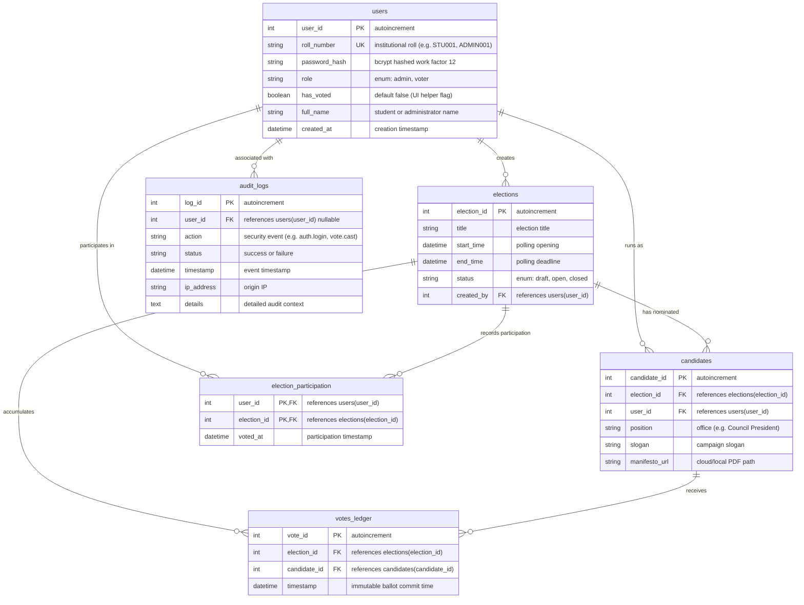

# SecureVote — Entity-Relationship (ER) Diagram

The following Mermaid ER Diagram models the 5 primary Third Normal Form (3NF) relational tables and the `election_participation` entity, illustrating primary keys (PK), foreign keys (FK), unique constraints, and the zero-trust ballot secrecy decoupling.

---

## Architectural & Zero-Trust Highlights

1. **Strict 3NF Compliance**:
   - Every non-key column depends solely on the primary key, the whole key, and nothing but the key.
   - All foreign keys are indexed for high-performance join resolution.

2. **Decoupled Ballot Secrecy**:
   - `votes_ledger` explicitly omits `user_id`. It is mathematically and relationally impossible to query or reverse-engineer which voter cast a specific ballot.

3. **Multi-Election Participation**:
   - `election_participation` utilizes a composite primary key `(user_id, election_id)` ensuring a student can cast exactly one vote per election while preserving the ability to vote in subsequent elections.

4. **Append-Only Immutability**:
   - `votes_ledger` and `audit_logs` are protected by database engine triggers that raise exceptions on any `UPDATE` or `DELETE` statements.
